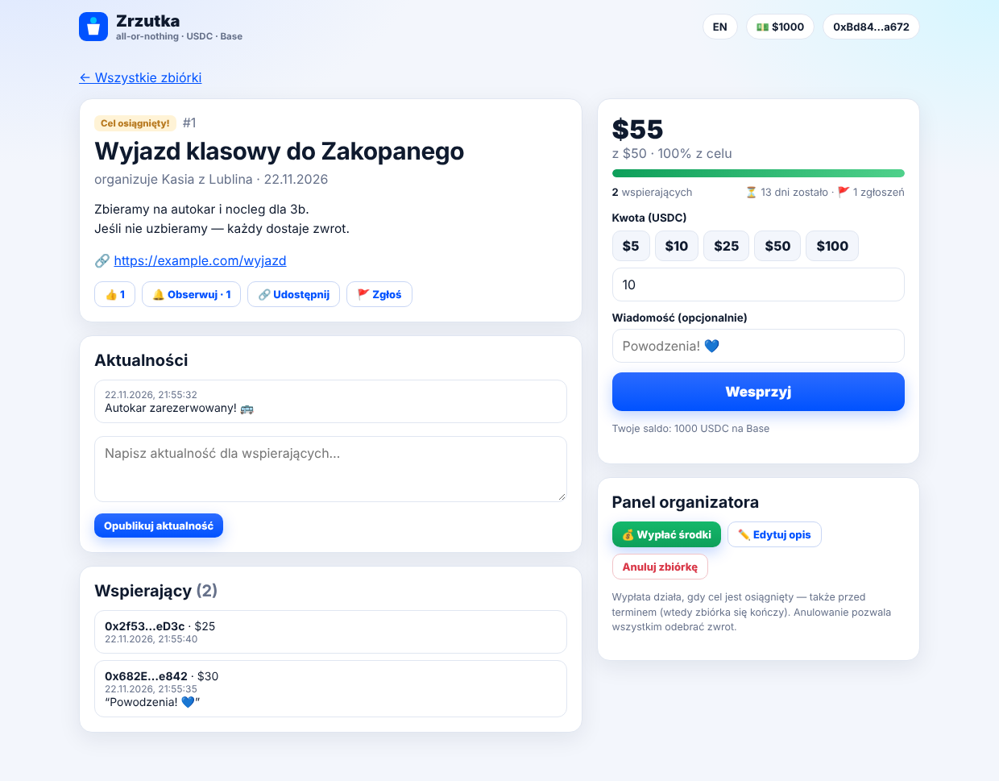
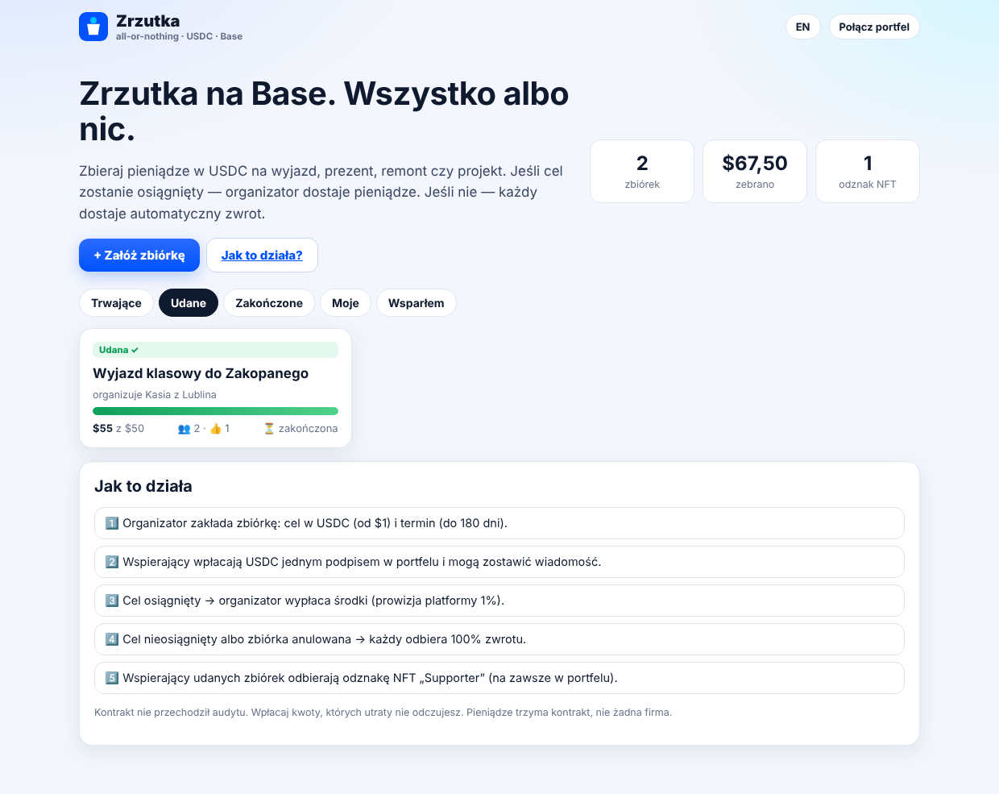
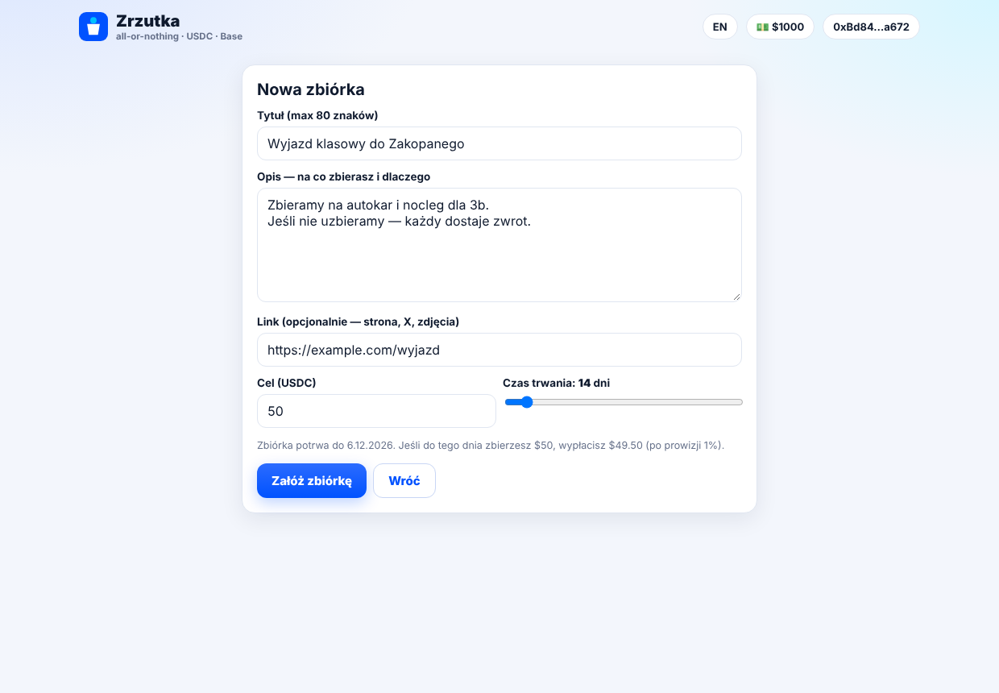
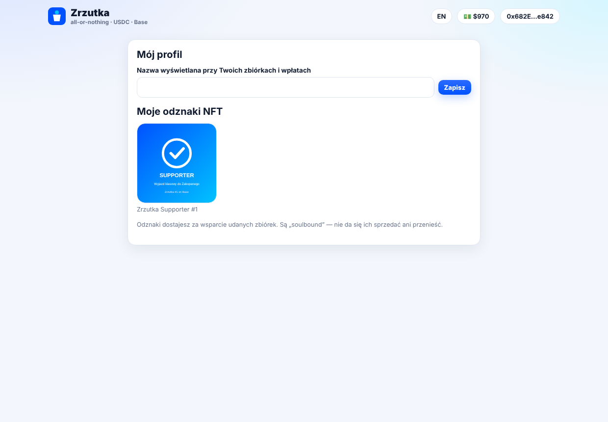
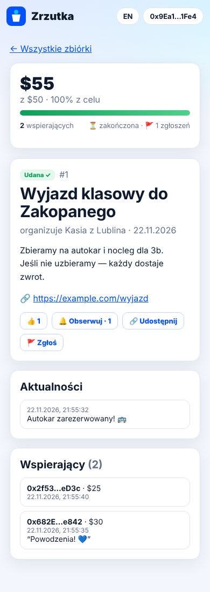

# 💙 Zrzutka — all-or-nothing crowdfunding on Base

**▶ Live app: https://0xdonaldjtrump.github.io/zrzutka/**

Zrzutka is a fundraising app on the **Base** network (Ethereum L2) that pays in **USDC**.
The rule is simple: **all or nothing**.

- 🎯 Goal reached → the organiser withdraws the money (1% platform fee).
- ↩️ Goal missed or campaign cancelled → **every backer gets 100% back**.
- 🏅 Backers of successful campaigns mint a soulbound **Supporter NFT** with on-chain SVG art.

No accounts, no backend, no company holding your money — the smart contract does it all.



## 🇵🇱 Po polsku

**Zrzutka** to zbiórka pieniędzy w USDC na sieci Base — na wyjazd klasowy, prezent, remont świetlicy czy projekt.
Działa na zasadzie **„wszystko albo nic”**: jeśli cel zostanie osiągnięty, organizator wypłaca środki; jeśli nie —
każdy wspierający odbiera pełny zwrot. Pieniądze trzyma kontrakt, nie żadna firma.

Co możesz zrobić w aplikacji:

| Organizator | Wspierający | Każdy |
|---|---|---|
| Załóż zbiórkę (cel, termin, opis, link) | Wesprzyj jednym podpisem (USDC permit) | 👍 Polub zbiórkę |
| Publikuj aktualności | Zostaw wiadomość przy wpłacie | 🔔 Obserwuj |
| Edytuj opis i link | Odbierz zwrot, gdy się nie uda | 🚩 Zgłoś nadużycie |
| Przedłuż termin (raz, do 30 dni) | Odbierz odznakę NFT, gdy się uda | ✏️ Ustaw nazwę profilu |
| Wypłać środki / anuluj zbiórkę | | 🔗 Udostępnij link |

## Features

- **USDC only** — native USDC on Base (`0x833589fCD6eDb6E08f4c7C32D4f71b54bdA02913`), so goals are in real dollars.
- **One-signature contributions** via EIP-2612 `permit`, with automatic `approve` fallback.
- **Campaign updates, backer messages, upvotes, follows, reports, profile names** — all stored on-chain.
- **Soulbound Supporter badges** (ERC-721) with fully on-chain SVG metadata.
- **Admin panel** for the owner: fee (max 5%), limits, pause, stop scam campaigns.
- **Bilingual UI** (PL / EN), works on mobile, EIP-6963 wallet picker (MetaMask, Coinbase Wallet, Rabby…).
- **Single static file** — `index.html` hosted on GitHub Pages.

## Screenshots

| Home | Create | Badges | Mobile |
|---|---|---|---|
|  |  |  |  |

## Repository layout

```
contracts/Zrzutka.sol      main contract (ERC721 badges + crowdfunding logic)
contracts/MockUSDC.sol     6-decimal ERC20 with permit, used in tests
scripts/compile.js         solc 0.8.24 → build.json
scripts/build.js           src/index.template.html + ABI/bytecode → index.html
src/index.template.html    the web app
test/*.test.js             contract tests (ganache, no network needed)
e2e/                       Playwright end-to-end test of the web app
docs/                      how it works, deploy guide, admin guide, screenshots
```

## Development

```bash
npm install
npm run compile
npm test
node scripts/build.js            # builds index.html (setup mode)
node scripts/build.js 0xAddress  # builds index.html for a deployed contract
```

More: [How it works](docs/HOW-IT-WORKS.md) · [Deploy](docs/DEPLOY.md) · [Admin](docs/ADMIN.md)

## ⚠️ Disclaimer

The contract has **not been audited**. Only contribute amounts you can afford to lose.
Report vulnerabilities privately — see [SECURITY.md](SECURITY.md).

## License

[MIT](LICENSE) © 0xdonaldjtrump

**Tags:** base · base-network · usdc · crowdfunding · fundraising · all-or-nothing · kickstarter · nft · erc721 · solidity · web3 · dapp · zrzutka · polska
